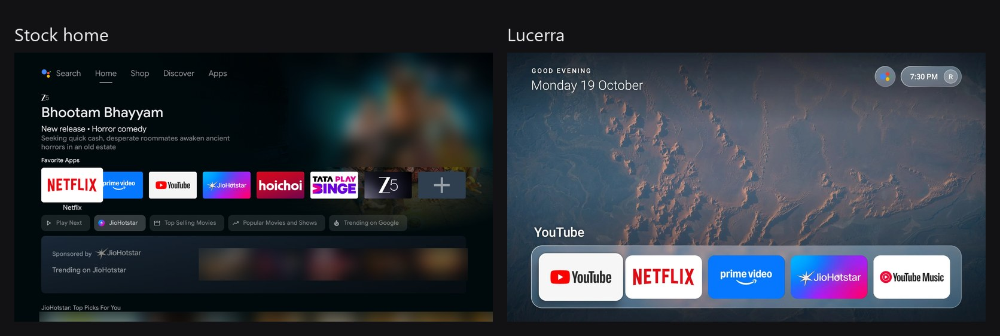
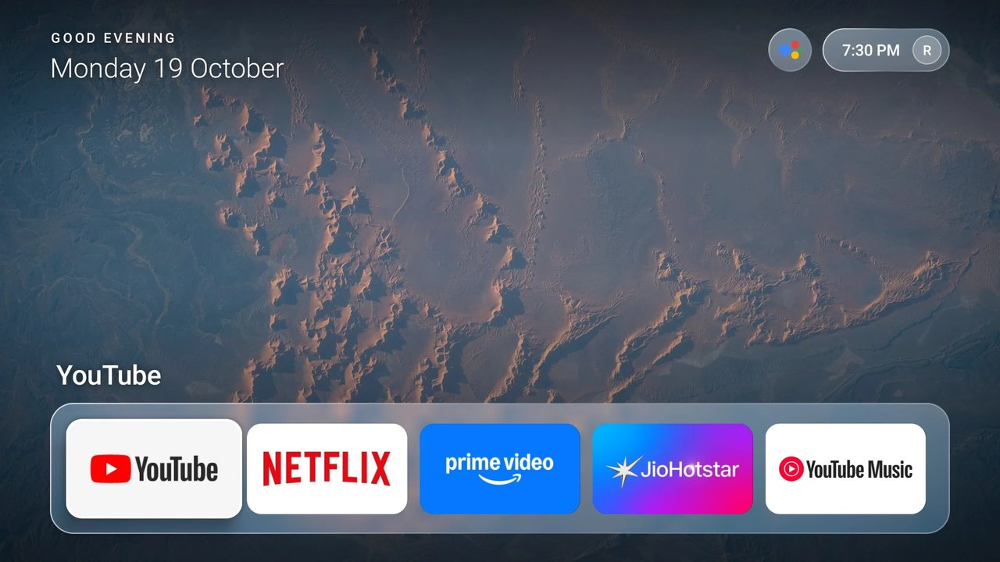
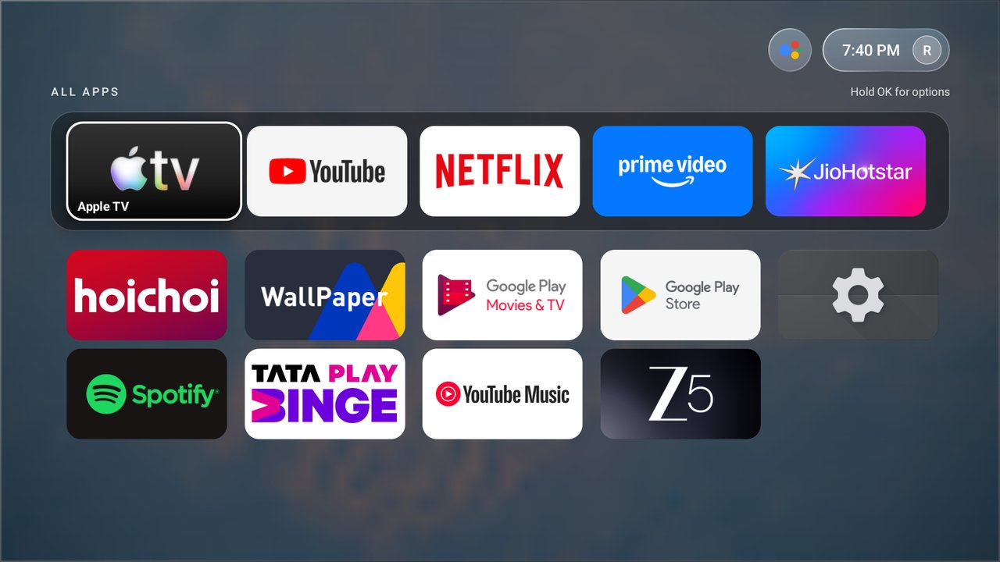
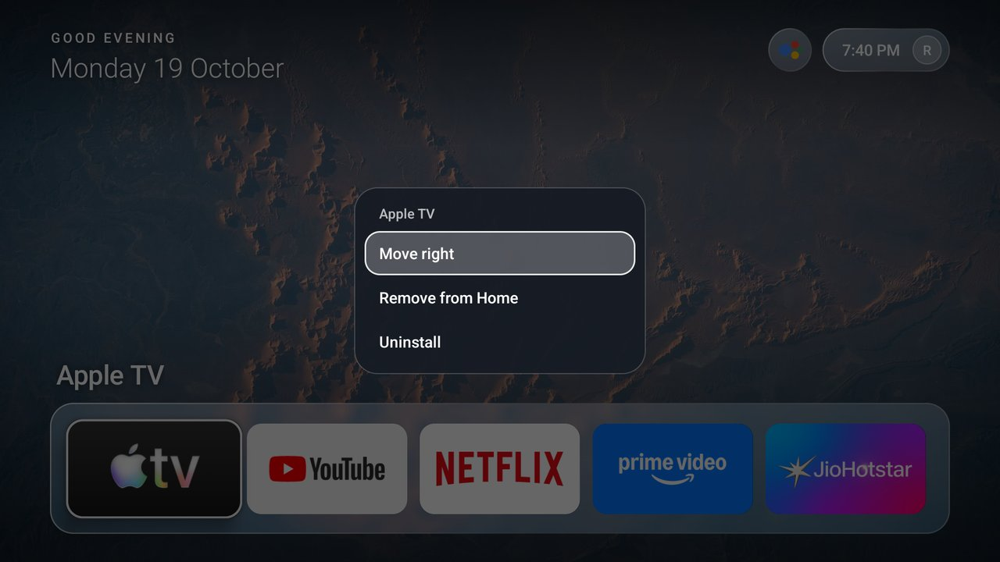

# Lucerra Launcher

A fast, ad-free home screen for Android TV and Google TV. Five apps, a glass dock, a calm wallpaper.



## What is Lucerra?

The stock Google TV home is a wall of sponsored posters, recommendation rows and ads. It is heavy, and
on a Mi Box 4K it is slow.

Lucerra replaces it with one thing: your five favourite apps in a frosted-glass dock over a rotating
NASA photo. Nothing else.



- **Five favourites on Home.** Pin, reorder or remove them with a long press of OK.
- **All Apps** is one press of Up away.


- **No ads, no recommendations, no network permission, no background services.**
- **Now Playing.** A glass widget shows the current track from Spotify or any app with a media session.
- **Remote apps button.** The key the system sends to TV Settings opens All Apps instead.
- **Light.** About 47 MB of memory and about 3% janky frames while scrolling, measured on a Mi Box 4K.
- **Spring-driven focus motion** that can be interrupted mid-flight. "Effects: Reduced" gives opaque panels and no motion (also auto-on if system animations are off).
- **Real glass, cheaply.** Real-time blur is too slow on this hardware, so each wallpaper is blurred once and the dock samples it.

## Install

Download `Lucerra-Launcher-v0.1.0.apk` from [Releases](../../releases), then:

```
adb connect <tv-ip>:5555
adb install -r Lucerra-Launcher-v0.1.0.apk
```

### Make it the default Home

The stock home wins the Home key, so disable it (reversible). Tested on a Mi Box 4K (Android 12):

```
powershell -File tools/debloat.ps1 -Device <tv-ip>:5555   # disables stock home, recommendations, Xiaomi analytics, MiTV channel/plus, Play Games
powershell -File tools/restore.ps1 -Device <tv-ip>:5555   # puts everything back
```

Other Android TV boxes work too; edit the package list in `tools/debloat.ps1` to suit.

### Remote apps button

The remote's apps button (key 284) is claimed by the system. Enable the Lucerra accessibility service
(Settings > Accessibility, or the command below) and it opens All Apps. The same service opens the
Power dialog.

```
adb shell settings put secure enabled_accessibility_services dev.raj.lucerra/dev.raj.lucerra.KeyService
adb shell settings put secure accessibility_enabled 1
```

### Now Playing

Android only shows other apps' media sessions to an app with notification access. Lucerra's listener
class contains no code, so it reads no notifications. Grant it once:

```
adb shell cmd notification allow_listener dev.raj.lucerra/dev.raj.lucerra.NowPlayingListener
```

Use `cmd notification allow_listener` rather than writing the secure setting directly: the direct write
overwrites the other allowed listeners and was not picked up by the system.

## Using it

- **Up** from the shelf opens All Apps: your favourites in a strip on top, every other app below. Back closes it.
- **Hold OK** on an app in the grid: Add to Home (five at most) or Uninstall.
- **Hold OK** on a favourite: Move left, Move right, Remove from Home.



- **Up** again from the strip reaches the Assistant bubble and the clock pill. The pill opens Wi-Fi, Settings and Power.
- Favourites are stored in app preferences and survive reboots.
- To change the default favourites or hide packages, edit `app/src/main/res/values/config.xml`.
- To show your photo in the clock pill, add a square `app/src/main/assets/profile.jpg` (otherwise the initial from `profile_initial` in `config.xml`).
- Six scenery photos live in `app/src/main/assets/wallpapers/`. Drop more 1920x1080 JPEGs there; they crossfade every 10 minutes.

## Build from source

Needs JDK 17 and the Android SDK (platform 34). Create `local.properties` with
`sdk.dir=C:/path/to/Android/Sdk`, then:

```
./gradlew assembleDebug
adb install -r app/build/outputs/apk/debug/app-debug.apk
```

`./gradlew assembleRelease` signs with `keystore.properties` from `~/.lucerra-signing/` (or
`$LUCERRA_SIGNING_DIR`). If that file is missing it falls back to the debug key, so anyone can build.

## Licence, name and credits

GPL-3.0, see [LICENSE](LICENSE). Forks must stay open source under the same licence. The name
"Lucerra" and its logo are not licensed for use on forks.

The wallpapers are NASA public-domain photos, credited in [WALLPAPER-CREDITS.md](WALLPAPER-CREDITS.md).
Lucerra is not affiliated with or endorsed by NASA, Google or any app shown in the screenshots. App
names and logos belong to their owners.
